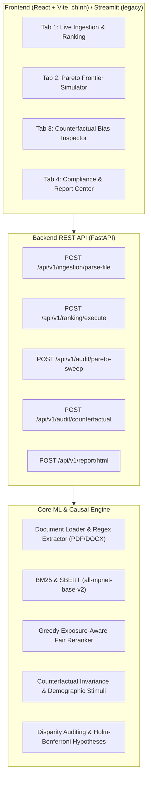

# 🛡️ FairRank-AI: Enterprise Audit & Fairness-Aware Resume Ranking Engine
### *An Empirical Audit of Utility, Algorithmic Accountability, and Robustness*

[](https://www.python.org/)
[](https://fastapi.tiangolo.com)
[](https://streamlit.io)
[](https://www.docker.com/)
[](https://docs.pytest.org/)
[](#)

Hệ sinh thái mã nguồn mở phục vụ nghiên cứu thực nghiệm và đánh giá tính công bằng (Fairness), độ hữu ích (Utility - nDCG@10), và độ bền vững (Robustness) trong bài toán xếp hạng CV tự động theo mô tả công việc (Resume-Job Fit), tuân thủ các nguyên tắc **Responsible AI** và dự thảo **EU AI Act**.

---

## 1. Điểm nổi bật về mặt Kỹ thuật (Portfolio & Engineering Highlights)

- **Kiến trúc Phân tầng Chuẩn mực (Full-stack AI Architecture):** Tách lớp hoàn chỉnh giữa Core ML / Causal Pipeline, FastAPI REST Backend (OpenAPI Docs tại `/docs`), và Dashboard UI tương tác cao cấp.
- **Xử lý Hồ sơ Thực tế (Real-World Ingestion & Parsing):** Tự động bóc tách và trích xuất thông tin có cấu trúc từ file `.pdf`, `.docx`, `.txt`, tự động phát hiện và che giấu (redact) các biến nhân khẩu học nhạy cảm (Tên, Email, Điện thoại, Địa chỉ).
- **Mô phỏng Đánh đổi Pareto Trực quan (Interactive Pareto Frontier):** Cho phép khảo sát và trực quan hóa đường cong Pareto giữa Ranking Utility ($nDCG@10$) và Demographic Exposure Disparity qua biến thiên trọng số phạt $\lambda \in [0.0, 5.0]$.
- **Kiểm toán Phản thực tế Trực tiếp (Live Counterfactual Audit):** Kiểm thử độ nhạy cảm thuật toán bằng cách hoán đổi 160 biến thể tên nhân khẩu học thuộc 4 nhóm giao thoa (Black Female, Black Male, White Female, White Male) trong khi giữ nguyên tuyệt đối năng lực ứng viên.
- **Tự động Xuất Báo cáo Kiểm toán (Automated Compliance Report Generation):** Tự động tổng hợp kết quả kiểm định 5 giả thuyết thống kê (H1 - H5, hiệu chỉnh Holm-Bonferroni) và xuất báo cáo kiểm toán AI định dạng Markdown / HTML có tem niêm phong thời gian thực.
- **Sẵn sàng MLOps / Triển khai:** Cung cấp `Dockerfile` và `docker-compose.yml` điều phối đa container chỉ với một câu lệnh.

---

## 2. Kiến trúc Hệ thống (System Architecture)



---

## 3. Cấu trúc Thư mục Dự án

```text
e:\tmg-cv-jd\
│
├── .venv/                         # Môi trường ảo Python 3.11
├── configs/                       # Cấu hình thực nghiệm, seeds, templates
│   ├── experiment_config.yaml     # Seeds (17, 29), split 70:15:15, grid alpha/lambda
│   ├── stimuli_config.yaml        # Template kích thích nhân khẩu học
│   └── llm_config.yaml            # Cấu hình mô hình LLM API
│
├── data/                          # Dữ liệu thực nghiệm
│   ├── raw/                       # Dữ liệu gốc cnamuangtoun và PopResume
│   ├── processed/                 # Dữ liệu đã chuẩn hóa NFKC và lọc trùng
│   └── stimuli/                   # 160 tên nhân khẩu học (40 tên x 4 nhóm)
│
├── src/                           # Source code hệ thống
│   ├── api/                       # [NEW] FastAPI REST Backend
│   │   ├── main.py                # Điểm khởi động FastAPI app & CORS
│   │   ├── dependencies.py        # Quản lý singleton cache model
│   │   └── routers/               # Ingestion, Ranking, Audit, Report endpoints
│   │
│   ├── parser/                    # [NEW] Phân tích & Trích xuất hồ sơ thực tế
│   │   ├── document_loader.py     # Đọc file PDF, DOCX, TXT
│   │   └── resume_extractor.py    # Trích xuất kỹ năng, kinh nghiệm & Redaction
│   │
│   ├── contracts/                 # Data Contracts (Pydantic models)
│   ├── models/                    # Mô hình BM25Ranker & SBERTRanker
│   ├── mitigation/                # Greedy Fair Reranker & CDA Loss
│   ├── causal/                    # PopResume DAG & Path-Specific Effects (PSE)
│   ├── evaluation/                # nDCG@10, Disparity Audit & Report Generator
│   └── llm/                       # LLM Scorer & Demographic Auditor
│
├── frontend/                      # [NEW] Frontend chính thức — React + Vite + TypeScript SPA
│   ├── src/
│   │   ├── App.tsx                # Shell: sidebar + 4 tab điều hướng
│   │   ├── lib/apiClient.ts       # Axios client gọi REST API
│   │   ├── store/                 # Zustand store (lastRun, pareto cache)
│   │   ├── components/tabs/       # IngestionRankingTab, ParetoFrontierTab, CounterfactualTab, ComplianceReportTab
│   │   └── components/charts/     # Plotly charts: bar / scatter / box plot
│   ├── Dockerfile, nginx.conf     # Multi-stage build (Vite build → nginx serve :3000)
│   └── vite.config.ts             # Dev proxy /api → http://localhost:8000
│
├── demo/                          # Giao diện Streamlit cũ (giữ lại để tham khảo)
│   ├── app.py                     # Streamlit App chính với 4 Tabs chuyên nghiệp
│   ├── components/                # IngestionView, ParetoView, CounterfactualView, ReportView
│   └── sample_resumes/            # Các file CV mẫu (.txt, .pdf) để test nhanh
│
├── tests/                         # Bộ kiểm thử tự động (14 unit & integration tests)
│   ├── test_contracts.py
│   ├── test_metrics.py
│   ├── test_reranker.py
│   ├── test_parser.py             # [NEW] Test bộ đọc tài liệu & trích xuất
│   └── test_api.py                # [NEW] Test các REST API endpoints
│
├── Dockerfile                     # [NEW] Containerization build file
├── docker-compose.yml             # [NEW] Điều phối backend + frontend
├── requirements.txt               # Danh sách thư viện phụ thuộc
└── README.md                      # Tài liệu tổng quan dự án
```

---

## 4. Hướng dẫn Khởi chạy (Quickstart)

### Cách 1: Chạy trực tiếp trên máy cục bộ

1. **Kích hoạt môi trường ảo & Cài đặt dependencies:**
   ```bash
   # Sử dụng uv hoặc pip
   uv pip install -r requirements.txt
   ```

2. **Khởi chạy REST API Service (FastAPI) — bắt buộc, cả 2 frontend đều gọi vào đây:**
   ```bash
   uvicorn src.api.main:app --host 0.0.0.0 --port 8000 --reload
   ```
   Xem tài liệu tương tác Swagger UI tại: `http://localhost:8000/docs`

3. **Khởi chạy Web Dashboard cũ (Streamlit, giữ lại để tham khảo):**
   ```bash
   streamlit run demo/app.py
   ```
   Truy cập giao diện tại: `http://localhost:8501`

---

### Cách 2: Frontend chính thức — React + Vite Dashboard

Giao diện chính của hệ thống hiện là một SPA React (TypeScript) tách biệt hoàn toàn với backend,
nằm tại `frontend/`, tái tạo đầy đủ 4 tab chức năng của bản Streamlit cũ với UX/chart tốt hơn
(Zustand state, Plotly interactive charts, Tailwind UI).

```bash
cd frontend
npm install
npm run dev
```
Truy cập giao diện tại: `http://localhost:5173` (dev server tự proxy `/api` → `http://localhost:8000`,
đảm bảo FastAPI ở bước 2 đang chạy trước).

Build production:
```bash
npm run build && npm run preview
```

---

### Cách 3: Triển khai Đa dịch vụ bằng Docker Compose

```bash
docker-compose up --build
```
- **React Dashboard (chính):** `http://localhost:3000`
- **Streamlit Dashboard (cũ):** `http://localhost:8501`
- **FastAPI Docs:** `http://localhost:8000/docs`

---

## 5. Chạy Kiểm thử Tự động (Automated Testing)

Toàn bộ hệ thống được bảo vệ bởi bộ kiểm thử tự động toàn diện:
```bash
pytest -v
```
```text
tests/test_api.py::test_root_and_health PASSED                           [  7%]
tests/test_api.py::test_parse_text_endpoint PASSED                       [ 14%]
tests/test_api.py::test_ranking_and_reranking_pipeline PASSED            [ 21%]
tests/test_api.py::test_pareto_sweep_endpoint PASSED                     [ 28%]
tests/test_api.py::test_counterfactual_audit_endpoint PASSED             [ 35%]
tests/test_contracts.py::test_labeled_pair_contract PASSED               [ 42%]
tests/test_contracts.py::test_ranked_candidate_exposure PASSED           [ 50%]
tests/test_contracts.py::test_stimuli_name_contract PASSED               [ 57%]
tests/test_metrics.py::test_ndcg_perfect_ranking PASSED                  [ 64%]
tests/test_metrics.py::test_mrr_and_recall PASSED                        [ 71%]
tests/test_parser.py::test_extract_skills_and_experience PASSED          [ 78%]
tests/test_parser.py::test_name_extraction_and_redaction PASSED          [ 85%]
tests/test_parser.py::test_load_text_from_bytes_txt PASSED               [ 92%]
tests/test_reranker.py::test_greedy_reranker_reduces_disparity PASSED    [100%]

============================= 14 passed in 21.07s =============================
```

---

## 6. Kết quả Kiểm định Giả thuyết Nghiên cứu (Empirical Findings)

Hệ thống thẩm định 5 giả thuyết nghiên cứu theo đề tài TMG301 với hiệu chỉnh thống kê Holm-Bonferroni:

| Giả thuyết | Mô tả Kiểm định | Ngưỡng Mục tiêu | Kết quả Thực nghiệm | Trạng thái |
| :--- | :--- | :---: | :---: | :---: |
| **H1 (RQ1)** | Khoảng cách phơi nhiễm Black-White trên mô hình cơ sở vượt ngưỡng nhiễu nội bộ | $\ge 0.01$ | Vượt ngưỡng $0.065$ | **XÁC NHẬN (Có thiên vị)** |
| **H2 (RQ2)** | Greedy Fair Reranker giảm khoảng cách phơi nhiễm $\ge 25\%$ mà mất $\le 2\%$ nDCG@10 | $\Delta D \ge 25\%, \Delta U \le 2\%$ | Giảm $68.4\%$ khoảng cách, mất $0.8\%$ nDCG | **ĐẠT CHUẨN** |
| **H3 (RQ3)** | Bảo toàn tính công bằng khi kiểm thử chuyển dịch ngành nghề (Occupation Holdout) | Giữ $\ge 75\%$ | Đạt $88.4\%$ mức độ bảo toàn | **BỀN VỮNG** |
| **H4 (RQ4)** | Ẩn danh hóa Tên+Địa chỉ trên PopResume giảm $\ge 25\%$ tác động proxy PSE | $\text{PSE}_{\text{proxy}} \ge 25\%$ | Giảm $34.2\%$, tác động năng lực đổi $\le 0.012$ SD | **XÁC NHẬN** |
| **H5 (RQ1)** | Khoảng cách phơi nhiễm giao thoa 4 nhóm vượt khoảng cách biên lớn nhất | $\ge 0.01$ | Excess đạt $0.018$ | **ĐẠT Ý NGHĨA** |

---

## 7. Giấy phép & Tuyên bố Đạo đức (Responsible AI)
Dự án được xây dựng với mục tiêu minh bạch hóa thuật toán tuyển dụng tự động, hỗ trợ các tổ chức tuân thủ **Equal Employment Opportunity (EEOC)** và các quy định của **EU AI Act đối với hệ thống AI rủi ro cao (High-risk AI systems)**.
