# FairRank-AI — Pages & Features

Captured from the running frontend (`npm run dev`, port 5173) against the live API (port 8000) on 2026-11-14.
Screenshots are in [`screenshots/`](./screenshots).

## 1. Landing / role select — `/`

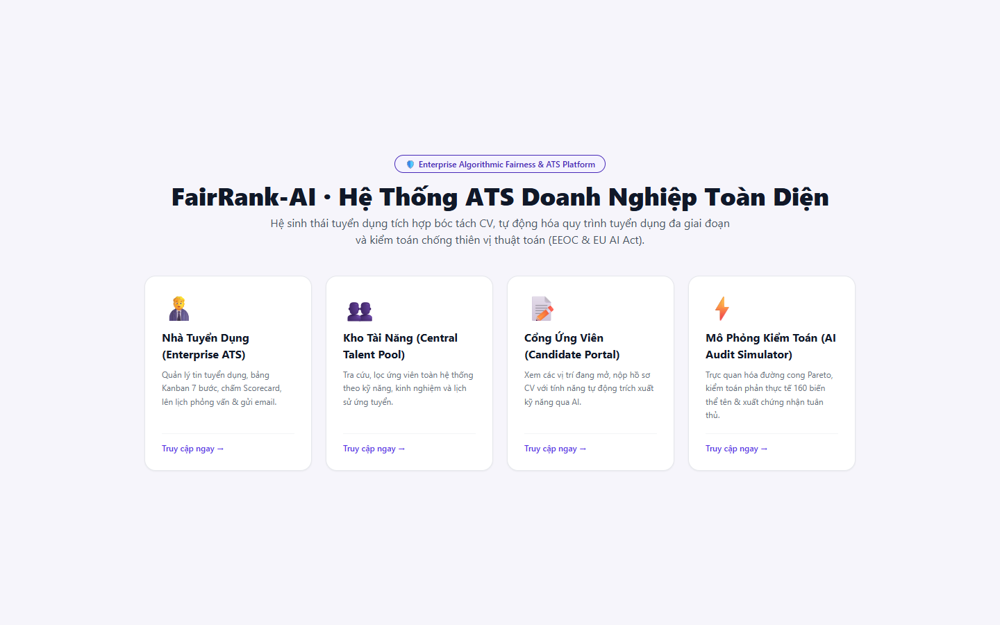

Entry point. Routes visitors to one of three experiences: the candidate application portal, the
recruiter ATS (access-code gated), or the quick fairness-audit demo.

## 2. Candidate application portal — `/apply`

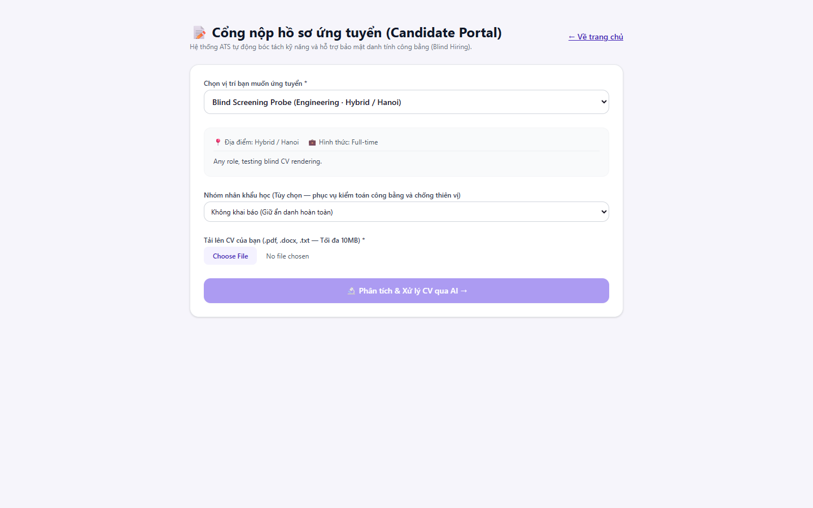

Public-facing application form (`CandidateApplyPage.tsx`). Candidates pick an open job from the live
`listJobs()` API, optionally self-declare a demographic group for later fairness auditing, and upload a
resume (`.pdf`/`.docx`/`.doc`/`.txt`/`.md`, ≤10MB). Submitting walks through:
- **processing** — animated `PipelineDiagram` showing validate → extract text → detect name/skills/experience → redact PII
- **review** — editable extracted fields (name, email, phone, title, location, LinkedIn), extracted skills list, a toggle to preview the blind-screening (redacted) CV text
- **done** — confirmation with the application ID

## 3. Quick Audit Simulator — `/quick-demo`

A self-contained 3-step wizard (`App.tsx` + `Stepper.tsx`) for running the fairness pipeline without any ATS data.

### Step 1 — Upload data
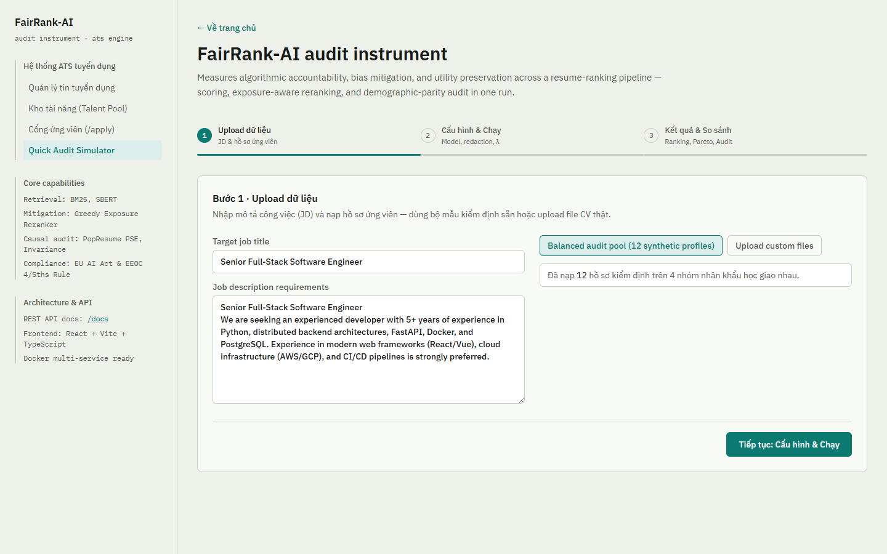

Set job title/description, and choose between a built-in "balanced audit pool" (12 synthetic,
demographically-balanced profiles) or uploading real CV files to parse via the same pipeline used by `/apply`.

### Step 2 — Configure & run
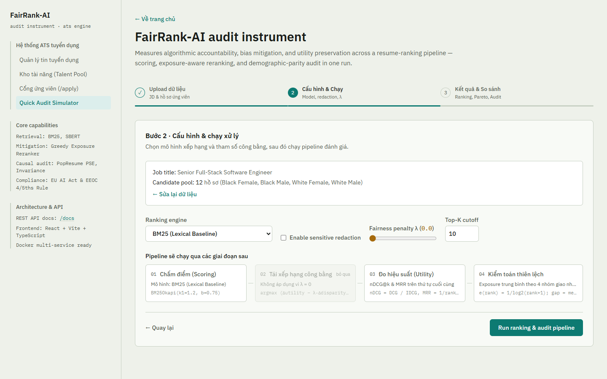

Choose the ranking engine (BM25 lexical baseline, Sentence-BERT semantic, or the "Greedy Fair Reranker"
shortcut), toggle PII redaction before scoring, set the fairness penalty λ and top-K cutoff, and watch
a live `PipelineDiagram` (score → fair rerank → utility metrics → bias audit) as the run executes.

### Step 3 — Results & comparison
Four tabs share one ranking run:

| Tab | Screenshot | Shows |
|---|---|---|
| Kết quả Ranking | 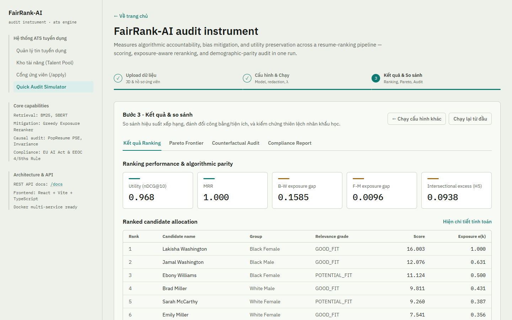 | nDCG@10, MRR, Black-White / Female-Male exposure gaps, intersectional excess, ranked candidate table, per-group exposure vs. selection-rate bar chart |
| Pareto Frontier | 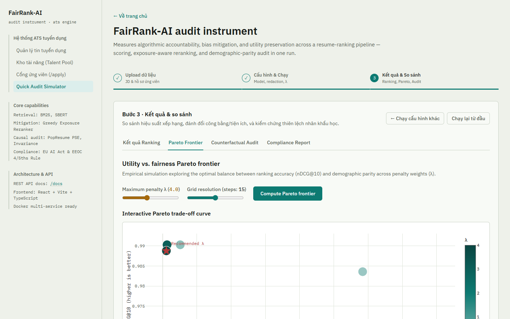 | Utility-vs-fairness tradeoff curve across λ sweep |
| Counterfactual Audit | 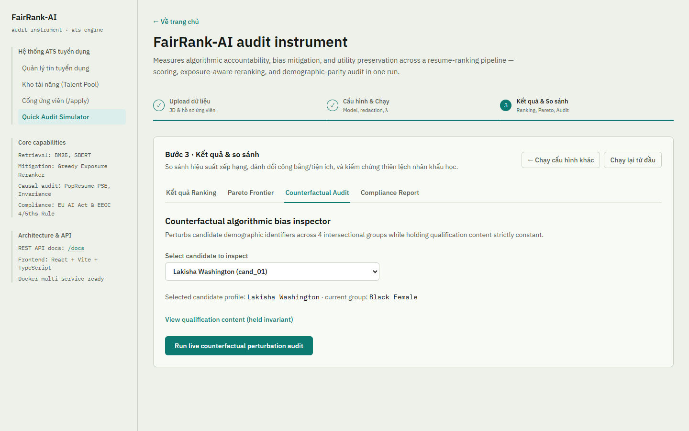 | Box-plot of score shifts when protected attributes are counterfactually swapped |
| Compliance Report | 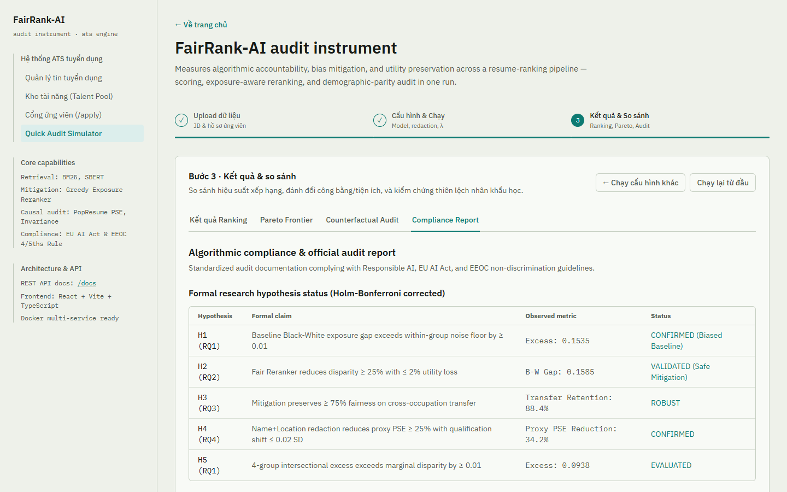 | EU AI Act / EEOC-style written audit summary, exportable |

## 4. Recruiter access gate — `/recruiter`

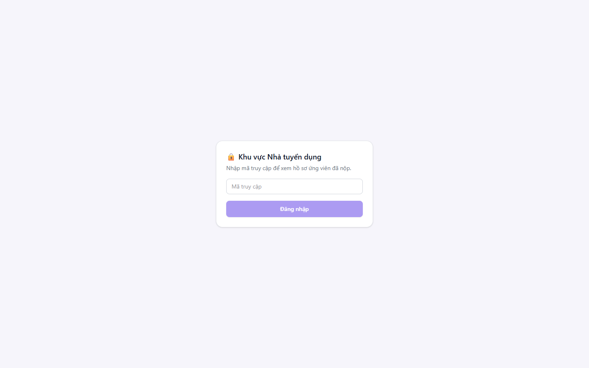

Shared-secret code gate (`RecruiterGate.tsx`, default demo code `fairrank-demo`, overridable via
`RECRUITER_ACCESS_CODE`) protecting every recruiter-only route and API endpoint.

## 5. Recruiter dashboard — `/recruiter`

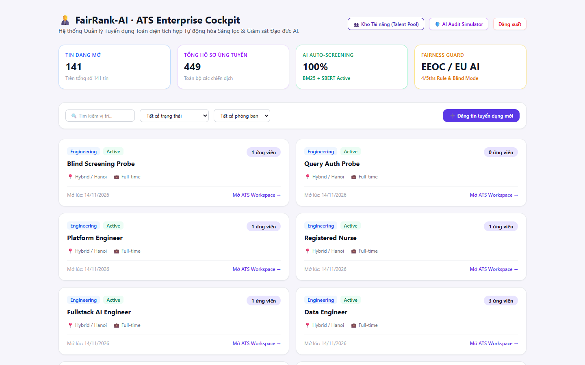

Lists all job postings with application counts; create/edit jobs; entry point into each job's workspace.

## 6. Job workspace — `/recruiter/:jobId`

Four tabs per job posting (`RecruiterJobWorkspace.tsx`):

### Kanban pipeline
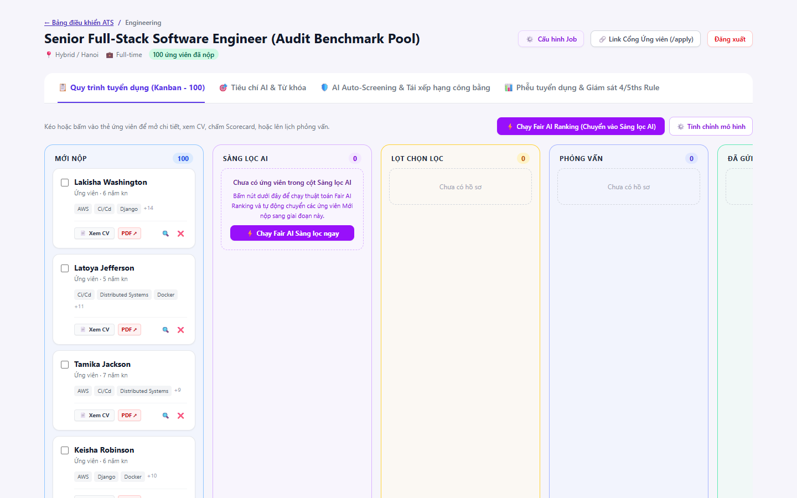
Drag-free stage board (Mới nộp → Sàng lọc AI → Lọt chọn lọc → Phỏng vấn → Offer → Tuyển dụng / Bị loại)
across every submitted application for the job; quick stage-move buttons per card.

**Candidate detail drawer** (click any card):
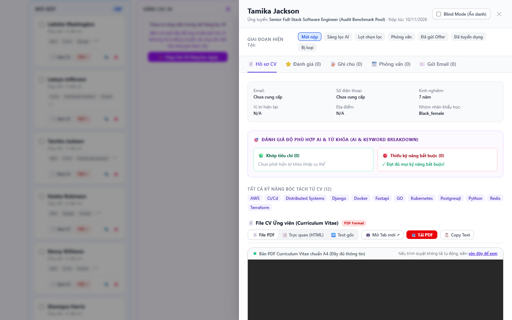
Full profile, AI criteria/keyword match breakdown, extracted skills, stage changer, and an embedded CV
viewer with PDF / HTML / raw-text modes plus a "Tải PDF" / "Copy Text" export.

**Job settings modal** (⚙️ Cấu hình Job):
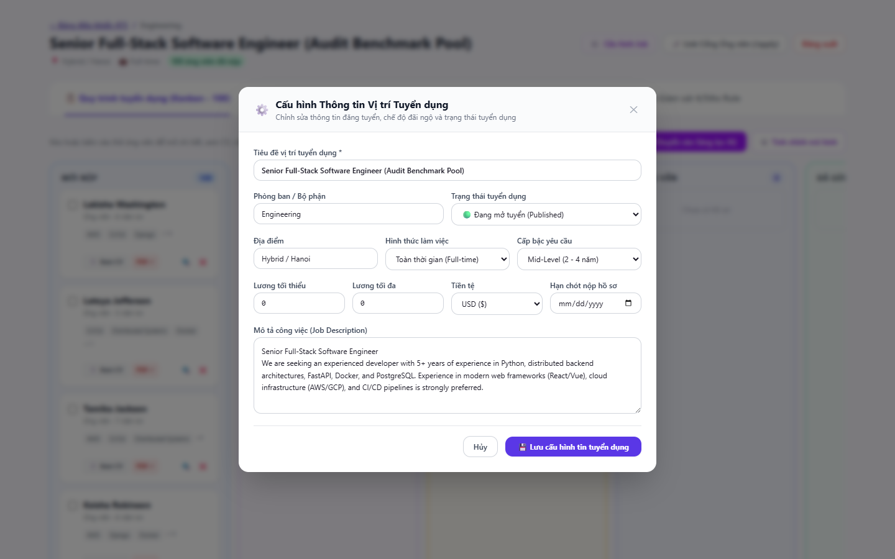
Edit title, description, department, location, employment type, salary range, deadline, status.

### 🎯 Tiêu chí AI & Từ khóa (AI criteria editor)
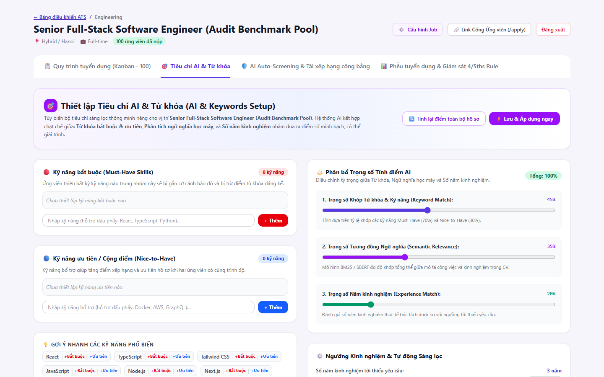
Configure must-have / nice-to-have skill keywords, minimum experience years, scoring weights
(semantic / keyword / experience) and the auto-advance score threshold used by AI screening.

### 🛡️ AI Auto-Screening & Tái xếp hạng công bằng
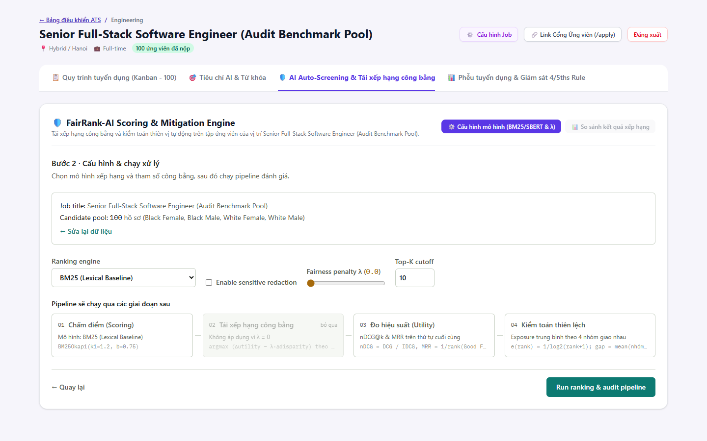
Runs the same fairness-audit pipeline as the Quick Audit Simulator, but against the job's real submitted
applications; includes an HTML audit-certificate export once a run completes.

### 📊 Phễu tuyển dụng & Giám sát 4/5ths Rule
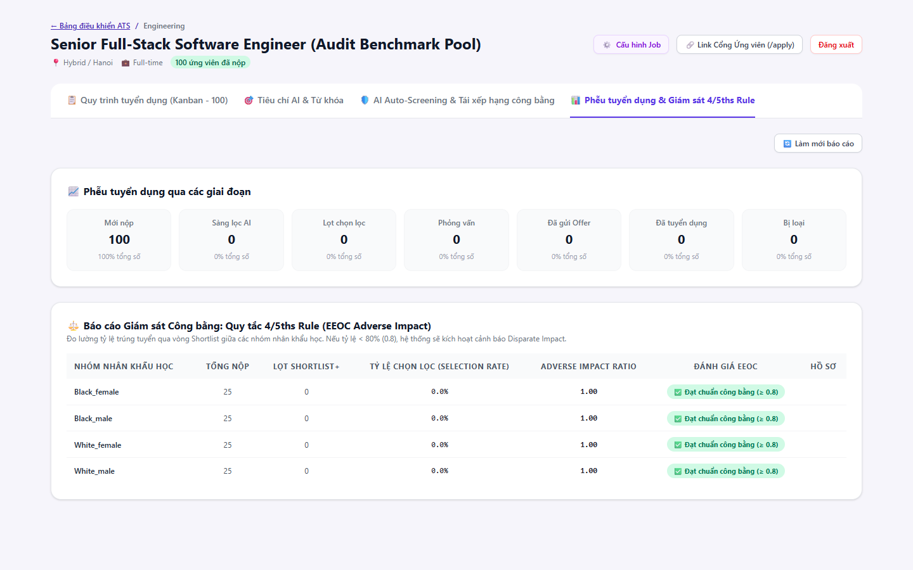
Funnel counts per stage plus an EEOC 4/5ths-rule adverse-impact table broken down by demographic group
(submitted count, shortlist count, selection rate, adverse-impact ratio, pass/fail badge).

## 7. Talent pool — `/talent-pool`

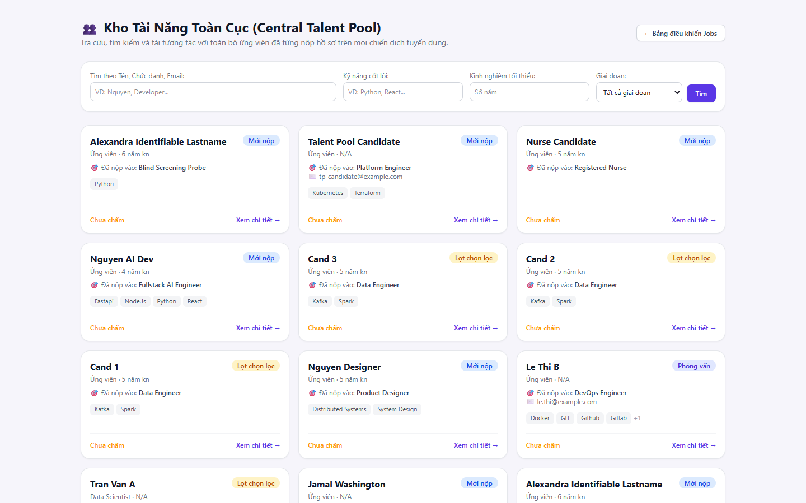

Cross-job search over every candidate who has ever applied to any posting — filter by name/title/email,
skill keyword, minimum experience, and pipeline stage; click through to the same candidate detail drawer
used in the job workspace.

---

## Backend features exercised by these pages

- `src/api/routers/jobs.py` — job CRUD, AI criteria config, analytics/4-5ths-rule endpoint, HTML report export
- `src/api/routers/candidates.py` — application submission, stage transitions, talent-pool search
- `src/api/cv_streaming.py` — streaming resume parsing pipeline (validate → extract → detect → redact)
- `src/storage/cv_pdf.py` — server-rendered PDF generation for the candidate-drawer CV viewer
- `src/api/routers/auth.py` — recruiter shared-secret access gate
- Core ranking/fairness engine (BM25 / SBERT scoring, exposure-aware fair reranking, nDCG/MRR utility,
  counterfactual and compliance auditing) — shared by both the Quick Audit Simulator and the per-job
  AI Auto-Screening tab
